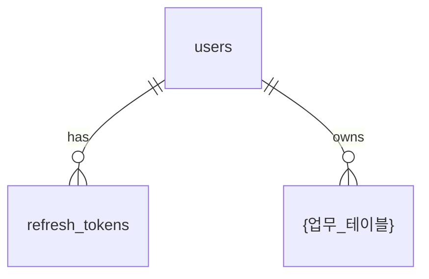

# 데이터베이스 설계서

> `{ }` 로 표시된 부분은 팀의 업무(주제)에 맞게 작성합니다.
> **3장 공통 테이블**은 업무와 무관하게 모든 팀이 사용하는 인증·보안용 테이블입니다.

## 1. 데이터베이스 구성

| 구분 | 사용 기술 | 비고 |
|------|-----------|------|
| RDBMS | MariaDB 또는 PostgreSQL | 버전: |
| Vector DB | FAISS 또는 Chroma | 저장 위치(볼륨): |
| 스키마 관리 | Flyway | `ddl-auto: validate` |
| 문자셋 | utf8mb4 | |

## 2. ERD

> ERD 도구(ERDCloud, dbdiagram.io 등)로 작성한 이미지로 대체해도 됩니다.

## 3. 공통 테이블 (필수)

### 3.1 users (사용자)
| 컬럼명 | 타입 | 제약조건 | 설명 |
|--------|------|----------|------|
| id | BIGINT | PK, AUTO_INCREMENT | 내부 식별자 |
| uuid | CHAR(36) | UNIQUE, NOT NULL | 외부 노출용 식별자 (JWT subject) |
| email | VARCHAR(100) | UNIQUE, NOT NULL | 로그인 ID |
| password | VARCHAR(255) | NOT NULL | BCrypt 해시 (평문 저장 금지) |
| name | VARCHAR(50) | NOT NULL | 이름 |
| role | VARCHAR(20) | NOT NULL | ROLE_USER / ROLE_ADMIN |
| failed_login_count | INT | DEFAULT 0 | 로그인 실패 횟수 (Brute Force 방어) |
| locked_until | DATETIME | NULL | 계정 잠금 해제 시각 |
| created_at | DATETIME | NOT NULL | 생성일시 |
| updated_at | DATETIME | NOT NULL | 수정일시 |

### 3.2 refresh_tokens (Refresh Token)
| 컬럼명 | 타입 | 제약조건 | 설명 |
|--------|------|----------|------|
| id | BIGINT | PK, AUTO_INCREMENT | |
| user_id | BIGINT | FK → users.id, NOT NULL | 토큰 소유자 |
| token_hash | CHAR(64) | UNIQUE, NOT NULL | SHA-256 해시 (평문 저장 금지) |
| expires_at | DATETIME | NOT NULL | 만료일시 |
| revoked | BOOLEAN | DEFAULT FALSE | 폐기 여부 (로그아웃·재발급 시) |
| created_at | DATETIME | NOT NULL | 발급일시 |

## 4. 업무 테이블

> 팀 주제에 맞게 작성합니다. 사용자가 소유하는 데이터는 **소유자 FK(`user_id`)** 를 반드시 포함합니다. (IDOR 방지의 근거)
> 테이블이 늘어나면 같은 양식으로 4.2, 4.3 … 을 추가합니다.

### 4.1 {테이블명} ({설명})
| 컬럼명 | 타입 | 제약조건 | 설명 |
|--------|------|----------|------|
| id | BIGINT | PK, AUTO_INCREMENT | |
| user_id | BIGINT | FK → users.id, NOT NULL | 소유자 |
| {컬럼명} | {타입} | {제약조건} | {설명} |
| created_at | DATETIME | NOT NULL | 생성일시 |
| updated_at | DATETIME | NOT NULL | 수정일시 |

### 4.2 {테이블명} ({설명})
| 컬럼명 | 타입 | 제약조건 | 설명 |
|--------|------|----------|------|
| id | BIGINT | PK, AUTO_INCREMENT | |
| | | | |

## 5. 테이블 관계

| 부모 테이블 | 자식 테이블 | 관계 | FK | 삭제 정책 (Cascade 등) |
|-------------|-------------|------|----|------------------------|
| users | refresh_tokens | 1:N | user_id | 사용자 삭제 시 함께 삭제 |
| users | {업무 테이블} | 1:N | user_id | |
| | | | | |

## 6. Vector DB 설계

| 항목 | 설정값 | 비고 |
|------|--------|------|
| Vector Store | FAISS / Chroma | |
| 임베딩 모델 | 개발: bge-m3(Ollama) / 배포: text-embedding-3-small(OpenAI) | 환경별로 인덱스 분리 |
| 벡터 차원 | 개발: 1024 / 배포: 1536 | |
| Text Splitter | | 예: RecursiveCharacterTextSplitter |
| 청크 크기 / 오버랩 | | |
| 검색 방식 | | similarity / mmr, k 값 |
| 저장 단위 | | 컬렉션(또는 인덱스) 구성 방식 |
| 메타데이터 | | 예: user_id, source(파일명), page |
| 사용자별 격리 방식 | | 메타데이터 필터 또는 사용자별 컬렉션 |
| 영속화 | | Docker 볼륨 경로 |

## 7. 인덱스 및 제약조건

| 테이블 | 인덱스/제약 | 컬럼 | 목적 |
|--------|-------------|------|------|
| users | UNIQUE | email | 중복 가입 방지 |
| users | UNIQUE | uuid | 토큰 subject 조회 |
| refresh_tokens | UNIQUE | token_hash | 토큰 조회 |
| | | | |

## 8. 마이그레이션 (Flyway)

| 버전 파일 | 내용 |
|-----------|------|
| V1__init.sql | 공통 테이블 생성 (users, refresh_tokens) |
| V2__{설명}.sql | 업무 테이블 생성 |
| | |

## 9. DB 계정 및 권한

| 계정 | 용도 | 부여 권한 |
|------|------|-----------|
| {앱 전용 계정} | 애플리케이션 접속 | 해당 DB의 SELECT, INSERT, UPDATE, DELETE (root 사용 금지) |
